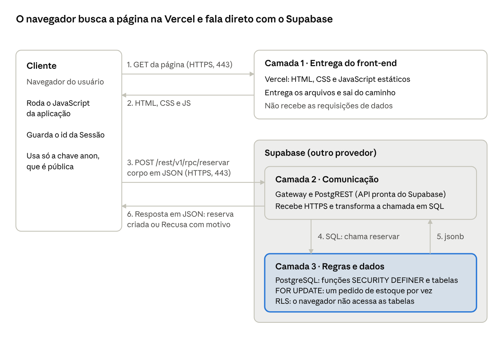

# Roteiro do vídeo NP2 - Venda de Ingressos

O vídeo responde a três partes de peso igual (até 3,3 pontos cada), e o link precisa estar no Teams até 10/11/2026: no dia 11 o sistema não aceita mais envios.

## Divisão do vídeo

São cerca de 10 minutos em 5 falas, um integrante por fala. O documento do professor não fixa duração, então esse tempo é uma sugestão, assim como os nomes.

| Fala | Critério de nota | Quem fala | Tempo | Na tela |
| --- | --- | --- | --- | --- |
| A. Proposta | Parte 1 | Guilherme | 1:30 | Página do Evento |
| B. Camadas | Parte 2 | Robert | 2:00 | Slide da conexão |
| C. Por que assim | Parte 2 | Caio Scorsoni | 2:15 | Slide da conexão |
| D. Do cliente à 3ª camada | Parte 3 | Caio Alves | 2:15 | Site com a aba Rede do DevTools |
| E. Concorrência e fechamento | Parte 3 | Gustavo | 2:00 | Duas janelas lado a lado e GitHub Actions |

## Parte 1: proposta do trabalho

### Fala A. Guilherme (1:30)

**Tela:** página do Evento aberta em sistema-distribuido-venda-ingressos.vercel.app.

"Olá, professor Marcelo. Somos o Caio Scorsoni, o Caio Alves, o Guilherme, o Gustavo e o Robert, e este é o nosso trabalho de Desenvolvimento de Sistemas Distribuídos.

Construímos um sistema web de venda de ingressos para um único evento, com quantidade limitada. O problema que ele resolve é clássico: quando várias pessoas, em máquinas diferentes, tentam comprar o último ingresso ao mesmo tempo, um sistema sem proteção vende mais do que existe.

O uso é simples. A pessoa informa o nome, sem criar conta, e escolhe a quantidade. Os ingressos ficam reservados para ela por um tempo limitado, enquanto ela confirma um pagamento simulado. Se confirmar, vira uma venda definitiva. Se cancelar ou o tempo acabar, os ingressos voltam a ficar disponíveis.

Nosso objetivo é mostrar que, mesmo com pedidos simultâneos vindos de máquinas diferentes, o sistema nunca vende além da capacidade. O Robert vai explicar como isso foi distribuído."

## Parte 2: arquitetura e camadas

### Fala B. Robert (2:00)

**Tela:** slide da conexão (diagrama mais abaixo). Apontar cada caixa ao falar dela.

"O sistema tem três camadas, distribuídas em dois provedores diferentes. O cliente é o navegador do usuário.

A camada 1 é a Vercel. Ela hospeda o front-end, feito em HTML, CSS e JavaScript puros. A função dela é entregar esses arquivos ao navegador.

A camada 2 é a API do Supabase, formada por um gateway e pelo PostgREST. Essa camada nós não programamos, ela já vem pronta na plataforma. Ela recebe as chamadas HTTPS e as transforma em comandos SQL.

A camada 3 é o PostgreSQL, também no Supabase. Nela ficam as tabelas e também as regras de negócio, escritas como funções dentro do banco: iniciar sessão, consultar evento, reservar, cancelar reserva e confirmar pagamento.

O que o grupo programou foram as duas pontas: o front-end e as funções no banco. Elas rodam em máquinas separadas e só conversam pela rede. O Caio vai explicar por que distribuímos dessa forma."

### Fala C. Caio Scorsoni (2:15)

**Tela:** slide da conexão, destacando a camada 3.

"Separamos assim porque cada parte tem uma necessidade diferente. O front-end é estático e não guarda estado, então a Vercel pode entregá-lo sem nenhuma coordenação entre servidores. Já o estoque é um estado compartilhado por todos e precisa de um único ponto de verdade. Por isso, a decisão de quem pode comprar fica onde o dado está: no banco.

Na NP1, nós propusemos uma API própria entre o front-end e o banco. Durante o desenvolvimento, mudamos essa decisão. Funções serverless rodam em instâncias independentes, que não compartilham memória, então o controle de concorrência teria que ficar no banco de qualquer forma. A API própria seria mais um salto de rede sem resolver o problema principal.

A proteção que ela daria foi mantida de outro jeito. Todas as tabelas têm RLS e o usuário anônimo não tem privilégio nenhum sobre elas. O navegador só consegue executar as funções publicadas, e nenhuma credencial administrativa chega a ele. Mesmo que alguém adultere o JavaScript, não consegue burlar o estoque.

Essa escolha tem um custo, e nós o aceitamos: o banco é um ponto único. Se ele ficar indisponível, as vendas param. Para venda de ingressos, preferimos parar a vender o que não existe."

> **Atenção à contagem de camadas:** o README e o ADR 0001 falam em "duas camadas", porque contam só o que o grupo programou. O professor pede "quais e quantas" e cita a 3ª camada, por isso o roteiro conta as três por onde o pedido passa. Todos devem usar o mesmo número no vídeo.

## Parte 3: do cliente até a 3ª camada

### Fala D. Caio Alves (2:15)

**Tela:** site em janela limpa, com o DevTools aberto na aba Rede, filtro Fetch/XHR. Dar zoom nas requisições.

"Agora, o que acontece do ponto de vista do cliente. Ao abrir o endereço, o navegador faz requisições HTTPS, na porta 443, e recebe o HTML, o CSS e o JavaScript. Até aqui, ele só falou com a camada 1.

*[Digitar o nome e clicar em Entrar.]*

Ao clicar em Entrar, o JavaScript chama a função iniciar_sessao. Vejam na aba Rede: é um POST, e o destino é o domínio do Supabase, não o da Vercel. A partir daqui, o navegador fala direto com a camada 2.

*[Escolher 2 ingressos e clicar em Reservar. Abrir a requisição reservar.]*

Este é o caminho completo. O navegador envia um POST para /rest/v1/rpc/reservar, com um JSON contendo a sessão e a quantidade. O gateway recebe, o PostgREST converte a chamada em SQL e o PostgreSQL executa a função reservar, na camada 3. O resultado volta pelo mesmo caminho, em JSON, e a tela mostra o Checkout.

A contagem regressiva usa o relógio do banco, e não o do computador do usuário, porque o banco é quem decide se o prazo acabou.

*[Clicar em Confirmar Pagamento simulado.]*

A venda foi registrada. Quando o sistema nega algo por regra de negócio, como falta de estoque, a resposta é um JSON normal com ok falso e o motivo. Já um erro técnico, como queda de rede, é tratado separadamente, e o usuário vê uma mensagem diferente. O Gustavo vai mostrar o que acontece quando dois clientes disputam o mesmo ingresso."

### Fala E. Gustavo (2:00)

**Tela:** duas janelas lado a lado, cada uma com uma Sessão, já na seleção de quantidade. Capacidade configurada em 1.

"Esta é a situação que justifica todo o sistema: duas sessões separadas e um único ingresso. As duas vão clicar em Reservar.

*[Clicar nas duas janelas o mais junto possível.]*

Uma conseguiu a reserva. A outra recebeu a mensagem de que não há ingressos suficientes. Isso acontece porque a função reservar trava a linha do evento com FOR UPDATE. Os pedidos entram em fila no banco, e cada um calcula o estoque só depois de obter a trava. O segundo já enxerga o que o primeiro gravou.

*[Mostrar a execução verde no GitHub Actions.]*

Um clique manual é só uma amostra, por isso automatizamos os testes. Em um deles, 20 sessões simultâneas, cada uma com seu próprio cliente, disputam 10 ingressos: o resultado são 10 reservas e 10 recusas. Em outro, induzimos uma falha no meio da transação e confirmamos o rollback: não sobra venda pela metade.

Em resumo: o front-end na Vercel, a API e o banco no Supabase, e a consistência garantida no único lugar que todos os clientes compartilham. Obrigado, professor."

## Slide da conexão

Este diagrama segue o formato da Figura 1 do documento do professor e aparece nas falas B, C e D.

A Vercel só participa dos passos 1 e 2. Cada reserva, venda ou consulta segue os passos 3 a 6, direto do navegador para o Supabase.

## Antes de gravar

- [ ] Fazer o merge do PR 18 ou tirar do roteiro a frase do rollback: o teste de falha induzida ainda não está na main (a execução do CI nesse PR passou).
- [ ] Combinar o Reinício da demonstração em /admin.html antes de cada tomada: ele apaga Vendas, Reservas e Sessões.
- [ ] Para a Fala E, salvar Capacidade 1 no Painel admin; depois da gravação, voltar ao valor anterior.
- [ ] Abrir as duas Sessões em navegadores diferentes ou em janela anônima: "Duplicar aba" copia a Sessão.
- [ ] Carregar as duas janelas antes de alguém reservar. Se uma clicar um pouco depois, ainda recebe a Recusa, porque o estoque na tela só muda ao atualizar.
- [ ] Transformar o diagrama em slide (print ou recriar) e treinar cada fala em voz alta, cronometrando.
- [ ] Postar o link no Teams até 10/11 e garantir a presença para assinar a ata em 12/11.
